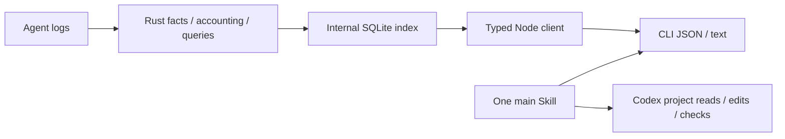
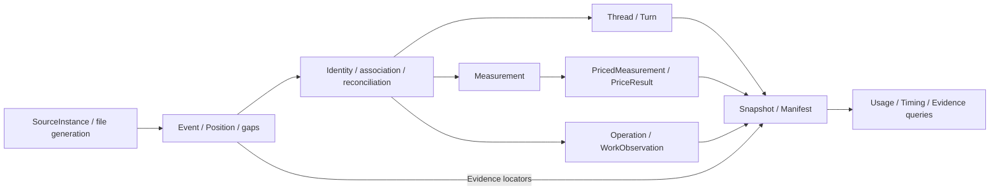

# Wombat Architecture

[中文](architecture.md) | English

Wombat is a local CLI and one main Skill for project engineering diagnosis and work analysis. The Skill selects evidence by user task. Rust owns source facts, accounting, storage and queries. Codex owns interpretation, project edits and validation. There is no project initialization phase or Web host.

## Data Flow

## Modules

| Module | Responsibility and public boundary |
|---|---|
| `core/` | Adapters, accounting, pricing, storage, foreground collection, and queries; an independent Rust library and executable, without UI framework dependencies |
| `client/` | Rust-generated DTOs, schema validation, `UsageClient`, stable errors, cancellation, and progress; the generic entry imports neither Node nor terminal libraries |
| `client/src/node/` | Bounded foreground core calls, subprocesses, official price downloads, timeouts, and output limits; exported as `@wombat/client/node` |
| `client/src/locale/` | Shared typed Chinese/English dictionaries, language selection, and presentation formatting; source content and protocol values stay untranslated |
| `cli/` | Arguments, JSON/text, exit codes and local query lifecycle; the default command shows task help without querying sources |
| `plugin/` | User plugins |

Dependencies point from `cli → client/node → core`. The main Skill reuses public CLI queries and Codex native project tools. No browser transport or UI package is shipped.

Business rules stay in Rust: adapters own source semantics and identity; `pricing.rs` / `pricing_sync.rs` own amounts and catalog eligibility; `live.rs` / `live_index.rs` own incremental indexes and versions; `usage_store.rs` owns immutable snapshots; `usage_app.rs` / `usage_app_dto.rs` own operations, filters, sorting, full-scope totals, and pagination. Lists never recompute totals, shares, or pricing from the current page.

## Foreground host responsibilities

The CLI supplies explicit source and project scope. The core owns version-bound evidence, user decisions and check facts. Codex acceptance does not establish resolution. Rechecks never revoke user decisions.

Each command owns a foreground core child. SQLite transactions provide internal consistency; no public view handle or resident service is required. Original diagnostic and cleanup results are passed back as recheck baselines.

## Domain and persistence

The following model describes current domain relationships. Rust owns rules and generates DTOs. A query result is not necessarily an entity.

### Domain map

Internal `Snapshot` and `Manifest` bind evidence within one query. Foreground processes close after each request; indexes and user decisions stay separate.

### Usage facts and derived results

`Position` establishes observation identity from the source, file, generation, offset, and ordinal. One operation can have multiple phase observations. Shared association uses explicit identities and aliases, not temporal proximity or text similarity. Event time and collection time remain separate; the latter does not replace the former. See [session_events.rs](../../core/src/session_events.rs).

`Measurement` is not necessarily a complete model call. It retains response or interval grain, model, time precision, Tokens, and unavailability reasons. Response identity and attribution can be absent. Adapters reconcile direct measurements with cumulative differences and deduplicate inherited fork observations. [Source acceptance](adapters.en.md) owns attribution and conservation rules.

`Operation` retains tool identity, merged results, outcome conflicts, and work observations. Proposed changes, terminal reports, and independently observed actual changes each need their own basis. Tool success does not prove a change. Lifecycle, time intervals, and repeated-operation analyses derive from events and shared association. They add no ledger measurements.

Pricing adds amounts and their basis to measurements without changing raw Token facts. Reasoning Tokens are a subset of output. Cache reads and cache creation remain separate. Missing, conflicting, indeterminate, zero, and unpriced values have distinct meanings. [Pricing](../reference/pricing.en.md) owns formulas, catalog versions, and update semantics.

### Configuration, checks, and rechecks

Configuration `Item` combines a physical current object and source memberships. `UseBasis` retains counting scope, method, provenance and coverage. Current configuration cannot establish historical loading. Related-turn usage is not configuration-owned cost. See [config_dto.rs](../../core/src/config_dto.rs).

`RuleAssessment` and `Finding` retain independent checks and specific problems. `Suggestion` supplies a baseline ID bound to the supplied original finding. Checks and rechecks are read-only; only explicit `UserDecision` writes to separate user storage. Rechecks require original scope and rules. Missing evidence cannot establish repair. See [optimize_dto.rs](../../core/src/optimize_dto.rs).

Codex owns authorized edits, tests, task creation and recovery. Wombat supplies selected evidence. Account observations remain independent and cannot establish project allowance consumption. See [account_dto.rs](../../core/src/account_dto.rs).

### Persistence boundaries and current model limits

Source transactions own recovery and association state. Query views share immutable facts, summaries, and version-bound locators; compressed observations support replay and evidence reads. Indexes and user decisions have separate storage. The [core reference](../reference/core.en.md) owns storage and resource limits; [contracts](contracts.en.md) owns generated fields and versions, and [privacy](../reference/privacy.en.md) owns retention and networking limits.

Parent relationships use events and a shared relationship index. Lifecycle uses phases and shared association. Neither has a unified public entity. A project is an evidenced directory attribution. Resource targets remain mainly attached to operations. `Collected` is a fact collection; `Snapshot` is a read view. Types with the same name must be read in their module context. A new entity needs an explicit query consumer.

## Development entry points

Use the [delivery workflow](workflow.en.md) for code conventions and verification, the [GitHub distribution decision](../decisions/implemented/architecture/2026-10-04-github-release-distribution.en.md) for release/runtime rationale, and [unfinished proposal](../decisions/proposed/product/2026-10-03-optimization-lifecycle.en.md) for outstanding acceptance. Host selection rationale belongs in the [earlier host decision](../decisions/implemented/architecture/2026-10-01-local-web.en.md); native execution ownership belongs in the [Codex decision](../decisions/implemented/architecture/2026-10-03-native-codex-handoff.en.md).
