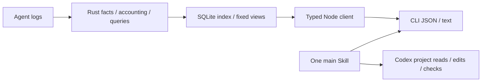
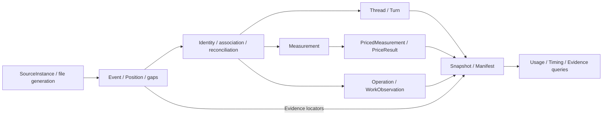

# Wombat 架构

中文 | [English](architecture.en.md)

Wombat 通过本地 CLI 和一个主 Skill 提供工程诊断与工作分析。Skill 按用户任务选取证据。Rust 负责来源事实、计量、存储与查询。Codex 负责解释、项目修改和验证。没有项目初始化阶段或 Web 宿主。

## 数据流

## 模块

| 模块 | 职责与公开边界 |
|---|---|
| `core/` | 适配器、计量、计价、存储、实时服务和查询；独立 Rust library 与可执行入口，不依赖界面框架 |
| `client/` | Rust 生成 DTO、Schema 校验、`UsageClient`、稳定错误、取消与进度；通用入口不导入 Node 或终端库 |
| `client/src/node/` | 受限内核通信、子进程、实时连接、官方价格下载、超时及输出上限；公开为 `@wombat/client/node` |
| `client/src/locale/` | 共享类型化中英字典、语言选择与纯展示格式化；原始内容和协议值不翻译 |
| `cli/` | 参数、JSON/文本、退出码与本地查询生命周期；默认命令显示任务帮助，不查询来源 |
| `plugin/` | 用户插件 |

依赖方向为 `cli → client/node → core`。主 Skill 复用公开 CLI 查询和 Codex 原生项目工具。不交付浏览器传输或 UI 包。

业务规则保留在 Rust：适配器拥有来源语义与身份；`pricing.rs` / `pricing_sync.rs` 拥有金额与价表资格；`live.rs` / `live_index.rs` 拥有增量索引与版本；`usage_store.rs` 拥有不可变快照；`usage_app.rs` / `usage_app_dto.rs` 拥有操作、筛选、排序、完整范围汇总和分页。列表不从当前页重算总量、占比或计价。

## 宿主与服务职责

CLI 提供明确的来源与项目范围。内核负责绑定版本的证据、用户决定与检查事实。Codex 接受任务不代表问题已解决，复查不能撤销用户决定。

## 业务与持久化

以下描述当前领域关系。Rust 拥有规则并生成 DTO；查询结果不一定是实体。

### 领域地图

| 读视图 | `Snapshot` 与 `Manifest` 固定查询证据 | 可重建索引与用户决定分别存储；Codex 原生工具负责创建任务 |

### 用量事实与派生结果

`Position` 以来源、文件、代次、偏移和序号建立观察身份。一个操作可对应多条阶段观察；共享关联使用显式身份与别名，不按时间接近或文本相似建立身份。事件时间与采集时间分别保存，后者不补齐前者。源码见 [session_events.rs](../../core/src/session_events.rs)。

`Measurement` 不等于完整模型调用。它保留响应或区间粒度、模型、时间精度、Token 与不可用原因；响应身份及归属可缺失。适配器核对直接计量与累计差值，并去重分叉继承。[来源验收](adapters.md)维护归属和守恒规则。

`Operation` 保存工具身份、合并结果、状态冲突与工作观察。提出变化、终止报告和独立观察到的实际变化各需依据，工具成功不证明变化。生命周期、时间区间、重复操作等分析从事件与共享关联推导，不新增账本计量。

计价为计量附加金额与依据，不改变原始 Token 事实。推理 Token 是输出的子集；缓存读取与缓存创建分别保存。缺失、冲突、不确定、零和未计价分别表达。[价格口径](../reference/pricing.md)维护公式、价表版本与更新语义。

### 配置、检查与复查

配置 `Item` 结合当前物理对象和来源成员，`UseBasis` 保留计数范围、方法、视图和覆盖。当前配置不能证明历史加载；关联轮次用量不是配置独占费用。见 [config_dto.rs](../../core/src/config_dto.rs)。

`RuleAssessment` 与 `Finding` 保留独立检查及具体问题；`Suggestion` 提供原视图绑定的基线 ID。检查与复查只读，只有显式 `UserDecision` 写入独立用户存储。复查必须使用原范围和规则；视图过期或证据不足不能当作修复。见 [optimize_dto.rs](../../core/src/optimize_dto.rs)。

Codex 负责授权编辑、测试、任务创建和恢复，Wombat 只提供选定证据。账户观察独立展示，不能推断项目额度消耗。见 [account_dto.rs](../../core/src/account_dto.rs)。

### 持久化边界与当前表达限制

来源事务负责恢复与关联；查询视图共享不可变事实、汇总及版本定位，压缩观察供重放与证据读取。索引与用户决定分开存储。[内核参考](../reference/core.md)维护存储与资源限制；[契约](contracts.md)维护字段与版本，[隐私](../reference/privacy.md)维护保留与联网边界。

父子关系由事件与共享关系索引表达，生命周期由阶段和共享关联表达；尚无统一公开实体。项目是有证据的目录归属；资源目标主要附着于操作。`Collected` 是事实集合，`Snapshot` 是读视图；同名类型需结合模块理解。新增实体需有明确查询消费者。

## 开发入口

代码规范和验证见[开发流程](workflow.md)，发行与运行时取舍见 [GitHub 分发决策](../decisions/implemented/architecture/2026-10-04-github-release-distribution.md)，未完成验收见[未完成提案](../decisions/proposed/product/2026-10-03-optimization-lifecycle.md)。宿主选型理由见[早期宿主决策](../decisions/implemented/architecture/2026-10-01-local-web.md)，原生执行归属见 [Codex 决策](../decisions/implemented/architecture/2026-10-03-native-codex-handoff.md)。
